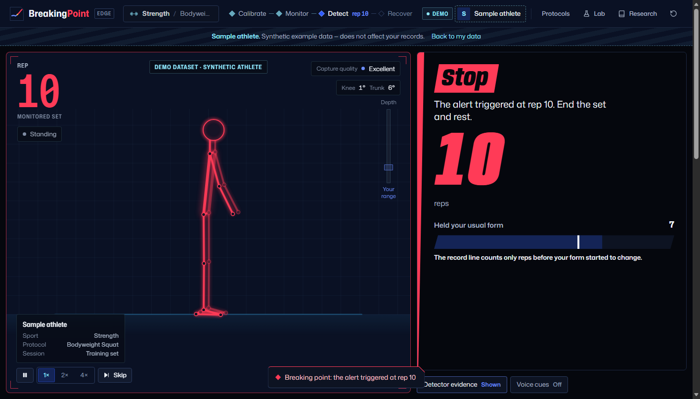

# BreakingPoint

BreakingPoint is a browser app that learns how an athlete moves when fresh and flags when their form keeps changing during a set. You do 5 to 8 controlled reps, and every rep after that is scored against them. Pose tracking runs on the device, so no video is uploaded.

I designed BreakingPoint and directed its implementation and evaluation. That included the movement pipeline, the athlete-specific scoring and change detection, a simulation study to choose the detector settings, and an evaluation on recorded human movement. I also decided which conclusions the results can support.

- Stack: React and TypeScript, MediaPipe Pose Landmarker running in the browser (WebAssembly and WebGL), a Python simulation lab with numpy, and Slurm jobs on UF HiPerGator.
- Methods: rep segmentation and per-rep features from pose landmarks, a baseline calibrated to each athlete, a standardized multivariate form-change score, an EWMA that decides when to alert, and a CUSUM that estimates when the change began.
- Experiments: a 100,000-session simulation on UF HiPerGator to choose the detector settings, and an exploratory evaluation on two public motion-capture datasets with protocols frozen before the outcomes were looked at.
- Results: on held-out simulated sessions, 2.2% false alerts and 89.6% of changes detected. On motion capture, personal baselines separated deliberate squat technique errors (mean AUC 0.92) much better than population norms (0.63). Changes after a jump fatigue protocol were small, and none of the six prespecified tests was significant.
- Not validated yet: real webcam footage processed through MediaPipe. BreakingPoint does not measure fatigue, predict injury or give medical advice.
- Try it: https://breaking-point-zeta.vercel.app. The demos run without a camera.



## How a session works

The app has four stages, and these are the names it uses:

1. Calibrate. 5 to 8 controlled reps at your normal tempo become your usual form.
2. Monitor. Each later rep gets a Form Change Score for how different it is from your usual form. The score has no direction, so a deeper squat and a shallower one both raise it.
3. Detect. When the smoothed score crosses the alert line, the athlete view says Stop and lists the measurements that changed most.
4. Recover. After a rest, three more reps show how much of the change has gone.

The squat and the countermovement jump are ready. The forward lunge is in beta: it works end to end on synthetic data, but its segmentation hasn't been checked on real footage. Sports are configuration on top of these movements. Soccer, basketball and volleyball use the jump, and pickleball, tennis and fencing use the lunge. A sport only changes which measurements are featured and how they're labelled; the detector and its weights stay the same.

The session screen has two parts. The athlete view is sized to be read from about 3 m. It shows the state, one instruction, the rep count, and a record line for reps held at your usual form. The detector evidence below it (chart, score, trend, ranked changes, baseline table) is for coaches; it opens by default in demos and stays closed in live sessions. Live sessions can run hands-free, with a countdown before calibration and before the set, and spoken cues are optional.

## Implementation

```
camera -> MediaPipe Pose (WASM/WebGL, on device) -> One Euro smoothing -> rep segmentation
       -> per-rep measurements -> personal baseline -> Form Change Score -> EWMA alert + CUSUM onset
```

### Pose tracking

MediaPipe's Pose Landmarker (full model) runs in video mode with the GPU delegate and falls back to the CPU. It returns 33 landmarks per frame. Each landmark coordinate goes through a One Euro filter (minimum cutoff 1.2 Hz, beta 0.05), which removes jitter when a joint is still without adding much lag during fast movement. The filter resets after a tracking gap longer than 0.5 s.

From the smoothed landmarks the app computes knee flexion, hip flexion, trunk lean from vertical, hip height and leg length, per side and only when the landmarks involved have visibility of at least 0.5. These are 2D angles in the image plane, not lab-grade joint angles. Since every comparison is with the same athlete from the same camera setup, a systematic projection bias mostly cancels.

### Rep segmentation

The squat segmenter works on hip drop divided by the athlete's own leg length, `d(t) = (hipY - standingHipY) / legLength`, so it doesn't depend on camera distance. A rep starts when `d` stays above 0.10 for two frames. Its start and end are the crossings of 0.06, and it counts only if the depth reaches 0.15 and the rep lasts between 0.6 s and 8 s. Losing tracking for more than 0.7 s aborts the rep.

The countermovement jump uses a separate state machine (standing, dip, propulsion, flight, landing). Take-off and touchdown come from the ankle rising above its standing height (0.035 and 0.015 leg lengths), with flight times outside 0.12 to 1.0 s rejected. The lunge reuses the squat's hip-drop machine with its own thresholds.

### Per-rep measurements

- Squat: left and right knee range of motion, hip range of motion, depth, peak trunk lean, rep, eccentric and concentric duration, peak knee-extension velocity, and the left-right knee difference.
- Countermovement jump: jump height (hip rise over leg length), RSI-mod (jump height over time to take-off), flight time, countermovement depth, dip and propulsion durations, peak trunk lean, landing knee flexion, and the left-right landing difference.

Each measurement carries a quality value from the visibility of the landmarks it depends on, and it needs at least 60% usable frames within the rep.

### Athlete calibration

The baseline comes from the calibration reps. For each measurement it stores a centre and a robust scale:

```
centre_i = median(x_i)        scale_i = max(SD_i, 1.4826 * MAD_i, absFloor_i, relFloor_i * |median_i|)
```

The median keeps one odd calibration rep from moving the baseline. With only 5 to 8 reps, both SD and MAD are noisy, so taking the larger one is the conservative choice. The floors are set near the smallest change a single camera can resolve (for example 2.5 degrees for knee range of motion and 2% of leg length for depth). Without them, a very consistent athlete would get tiny scales and be flagged for camera noise.

### Form Change Score

Each rep is scored as a weighted root mean square of its clipped z-scores (`driftScore` in the code):

```
z_i   = clip((x_i - centre_i) / scale_i, -6, 6)
score = sqrt( sum(w_i * z_i^2) / sum(w_i) )        w_i = group weight * quality
```

This is a standardized Euclidean (diagonal Mahalanobis) distance. A full Mahalanobis distance isn't usable here because with 5 to 8 calibration reps and about 10 measurements the covariance matrix is singular. Group weights stop correlated measurements from counting several times: both knees, hip range of motion and depth share one depth group at 0.5 each, the tempo measurements get 0.5 each, trunk lean has 1.0, and the left-right difference 0.75. Measurements that are missing or below 0.5 quality are dropped and the weights renormalized. If less than half of the weight is usable, the rep isn't scored and the detector keeps its previous state.

A leave-one-out pass over the calibration reps measures how far this athlete's own fresh reps fall from a baseline built without them. That gives an in-control level and spread (mu0, sigma0). Every later score is standardized as `s_t = (score_t - mu0) / sigma0` and clipped at 2.5 before it reaches the detectors.

### EWMA and CUSUM

The two detectors have different jobs.

The EWMA decides when to alert: `Z_t = 0.4 * s_t + 0.6 * Z_(t-1)`, with a warning at 1.0 and an alert at 2.0, in units of the athlete's own spread. There is no extra run-length rule, and the alert latches for the rest of the set. From a resting trend, one extreme rep can move Z by at most 0.4 x 2.5 = 1.0, half the alert level. If Z is already above about 1.67, though, a single rep can push it over. In the simulation, isolated bad reps caused false alerts in 3.9% of sessions.

The CUSUM, `C_t = max(0, C_(t-1) + s_t - k)`, estimates when the change began. The onset estimate is the first rep of the CUSUM's current run above zero, so the app reports both when it became confident and roughly where the change started. CUSUM-only and combined EWMA plus CUSUM detectors were candidates in the sweep below, and the selection rule picked the EWMA.

After a rest, the recovery check scores three reps against the original baseline and reports what share of the excess score has gone (recovered at 75% or more and below the warning line, partial at 40% or more).

The detector settings load from [`public/breakingpoint_detector_config.json`](public/breakingpoint_detector_config.json), the file the Lab exports. A parity test replays sessions generated by the Python Lab through the TypeScript code and requires the baselines, scores, trends and alert reps to match to within 1e-9, so the app runs the same detector that was evaluated. [TECHNICAL_NOTES.md](TECHNICAL_NOTES.md) has the remaining details and the reasoning behind them.

## Evidence

There are three kinds of evidence, and they answer different questions. Their numbers shouldn't be combined.

### 1. Detector selection on UF HiPerGator (synthetic, October 2026)

The Lab simulates individual athletes with known change points in eight scenarios: no change, an isolated bad rep, gradual change, sudden change, camera noise, landmark dropout, high natural variability, and change followed by recovery. The sweep crossed EWMA and CUSUM parameters, warning and alert thresholds, run-length rules, outlier clipping, feature weighting and missing-feature handling across four detector families. That gave 5,056 detector settings, each scored with 5 score variants, so 25,280 configurations in total. It ran on 100,000 simulated sessions as a 20-task Slurm array (job 44695919, 8 CPUs per task) plus a merge job (44695920). Of those sessions, 50,000 were used to choose the settings and 50,000 were held out to report them.

I used a fixed selection rule: at most 5% false alerts in every no-change scenario, then the configurations within 2 percentage points of the best miss rate, then the shortest median delay.

| Held-out result (selected EWMA detector) | Value |
|---|---|
| False alerts, all no-change sessions | 2.2% (95% CI 2.1 to 2.4%) |
| False alerts: no change / isolated bad rep / camera noise / dropout / high variability | 1.9 / 3.9 / 1.3 / 2.5 / 1.6% |
| Changes detected | 89.6% (95% CI 89.2 to 90.0%) |
| Detected: gradual / sudden / change then recovery | 87.1 / 90.5 / 91.2% |
| Median delay after the true change | 4 reps |
| Median error of the onset estimate | 1 rep |

| Detector family (held-out split) | False alerts | Missed | Median delay |
|---|---|---|---|
| Selected EWMA | 2.2% | 10.0% | 4 reps |
| Best CUSUM only | 3.0% | 9.5% | 4 reps |
| Best EWMA + CUSUM | 2.0% | 12.3% | 3 reps |
| Flag any rep above 2 | 51.9% | 1.5% | 1 rep |

The main design choice behind the app is the personal baseline, so I tested it directly. With the same detector but population norms in place of the personal baseline, false alerts rose from 2.2% to 17.8% (30.5% for highly variable athletes) and detection fell from 89.8% to 40.0%. That comparison used a separate 20,000-session set, which is why its detection rate isn't the 89.6% above.

All of this is simulated squat-like measurement data with a known ground truth. It shows how the detector behaves under controlled conditions, and nothing about real people, real cameras, jumps, lunges, specific sports, fatigue or injury. The report, Slurm job records and exported config are in [`results/`](results/), and [`results/PROVENANCE.md`](results/PROVENANCE.md) corrects two labels in the original report.

### 2. Measurement evaluation on recorded human movement (motion capture, October 2026)

To test the measurement and scoring code on real movement, I used two public motion-capture datasets. The marker data goes through a virtual camera and then into the app's own feature and scoring code. Markers are cleaner than webcam landmarks, so this is a best case for the measurements and doesn't test MediaPipe. A first pass checked segmentation and measurement agreement against the lab references. Strict squat segmentation reached F1 0.76. For jumps, flight time, propulsion duration and the left-right difference did not agree well enough; for squats, rep duration and the left-right difference did not. Before looking at the outcome labels, I froze the protocols, inclusion lists and analysis code by hash, and the analysis ran once. The datasets had been inspected during the earlier measurement checks, so it isn't a blinded study.

Jumps before and after a fatigue protocol ([Calisti, Mohr and Federolf 2025](https://doi.org/10.6084/m9.figshare.28890545.v1)): 43 participants with 3 jumps before and 3 after. The 38 with all six jumps measured form the primary sample. The fresh jumps were always recorded first, so every result is a change after the protocol, and fatigue can't be separated from order effects such as practice or warm-up.

- None of the six prespecified tests was significant after Holm correction. The smallest adjusted p-value was 0.063, for jump height.
- Jump height fell by 0.77% of leg length on average, about 0.8 cm, or -0.34 of each person's own spread (95% CI -0.57 to -0.11). RSI-mod fell by -0.54 (95% CI -0.93 to -0.15). Peak trunk lean rose by about 1.9 degrees, but that change was the least consistent across the sensitivity samples.
- With each person's fresh jumps as the baseline, the real fresh-versus-post split ranked 7.55 out of 20 on average (95% CI 5.55 to 9.56), where 10.5 would mean no separation. A baseline built from other people's jumps showed no separation (10.37).
- Within each block, the change from the first jump to the third was about as large as the shift between blocks.

Squats with deliberate technique errors (REHAB24-6, [Černek, Sedmidubsky and Budikova 2024](https://doi.org/10.5281/zenodo.13305826)): 9 people. The incorrect reps are mistakes performed on purpose, so this part says nothing about fatigue.

- Using each person's correct reps as the baseline, the shipped squat score separated correct from incorrect reps with a mean AUC of 0.92 (95% CI 0.83 to 1.00). No individual was below 0.67.
- A baseline built from other people gave a mean AUC of 0.63 (95% CI 0.31 to 0.94). For three people it scored the incorrect reps as more typical than the correct ones.
- 57% of the squat score's weight is on measurements that failed or weren't checked in the measurement-agreement pass, so a good separation doesn't validate each measurement.

The full results, with the order confound, missing data, all intervals and the two prespecified outputs the frozen code didn't produce, are in [`research/results/phase4b/README.md`](research/results/phase4b/README.md). The segmentation and measurement-agreement reports are in [`research/reports/`](research/reports/).

### 3. Webcam and MediaPipe validation: not done yet

None of the above uses real camera footage. That needs recorded sessions run through MediaPipe and compared with a reference for rep segmentation, measurement agreement and alert behaviour, under real lighting, clothing, occlusion and camera placement. Until that's done, the live camera mode is a working prototype. It has been tried by hand with a physical webcam and real movements: in an earlier version, and on 2026-10-16 on the M7 build with the checklist in [`docs/WEBCAM_SMOKE_TEST.md`](docs/WEBCAM_SMOKE_TEST.md), where the owner reports that everything tested worked. Those are manual functional checks, not measured results.

## Running it locally

The app needs Node 20 or newer, and the browser test suites need Node 22 or newer (tested with Node 24). The Lab needs Python 3.9 or newer with numpy and matplotlib. The research code needs Python 3.12 with the packages in [`research/requirements.txt`](research/requirements.txt).

```bash
npm install
```

Besides the npm packages, `npm install` copies the MediaPipe WASM runtime into `public/` and downloads the pinned pose model, checking its SHA-256.

```bash
npm run dev
```

The dev server runs at http://localhost:5173. To open a demo directly, add `?demo=strength`, `?demo=soccer`, `?demo=volleyball` or `?demo=pickleball` to the URL, and `&speed=4` to run it faster. During a demo, Space pauses, 1, 2 and 4 set the speed, and S skips to the end of the current stage.

## Tests

```bash
npm test
```

```bash
cd lab && python -m unittest discover -s tests
```

```bash
python -I -m unittest discover -s hpc/tests
```

```bash
python -I -m unittest discover -s research/tests
```

`npm test` covers the detector, the TypeScript and Python parity fixtures, the demo story, the sport and protocol layer, session protection, the wording rules and the checksums of the archived HiPerGator files. The Lab tests check the simulator's ground truth, the vectorized detector against the scalar reference, and the selection rule. Two browser suites run in headless Edge or Chrome. `npm run e2e:guard` checks session protection against `npm run dev`. `npm run e2e:release` runs the first-visit journeys against `npm run preview`: the demos, camera permissions, the evidence panel, phone width, keyboard use and reduced motion. The release suite uses the browser's fake camera, so it never opens a real one.

## Deploying

The repository is set up for Vercel through [`vercel.json`](vercel.json). The build runs `npm ci`, then `npm run build`, then [`scripts/check-assets.mjs`](scripts/check-assets.mjs), which fails the build unless `dist/` contains the pinned pose model and WASM runtime byte for byte. The model is pinned to one object generation of Google's file and to its SHA-256, so a different model would fail the build. There is no backend.

## Privacy

- Pose estimation runs on your device. Nothing is uploaded, and there is no server.
- Video isn't recorded. The app keeps only per-rep measurements.
- Athlete profiles, baselines and set history are stored in this browser's localStorage. Demos use a synthetic sample athlete held in memory and don't touch stored records.

## Limitations

- One camera can't see out-of-plane motion or a limb hidden behind the other one, and it has no true depth. That's why BreakingPoint only compares an athlete with their own reps from the same camera setup.
- Moving the camera or changing the lighting after calibration looks like a change in form. In the simulation, noise that increased only after calibration raised false alerts to 6.3% at 1.5 times the calibration noise and 17.3% at twice the noise. Recalibrate when the setup changes.
- Calibration uses 5 to 8 reps, so the baseline itself is uncertain. The measurement floors and the leave-one-out reference reduce this, but they don't remove it.
- The detector was tuned on simulated squat-like measurements. It hasn't been tuned separately for each movement or sport.

## Repository layout

```
src/            the app (React + TypeScript)
  pose/         MediaPipe wrapper, smoothing, drawing
  reps/         squat, jump and lunge segmentation
  biomechanics/ per-rep measurements and the shared catalog
  baseline/     personal baseline
  detection/    Form Change Score, EWMA/CUSUM detector, recovery check
  session/      session engine, runners, hands-free, voice cues, session protection
  components/   UI, including the athlete view and detector evidence (components/session/)
  protocols/    sports, protocols and movement primitives
lab/            Python Lab: simulator, vectorised detector, sweep, evaluation
hpc/            HiPerGator Slurm scripts and the run-output guard
results/        the original HiPerGator study: report, config, figures, job records, provenance
research/       motion-capture evaluation: adapters, protocols, frozen analysis, results
scripts/        asset setup and checks, readability tool, browser test suites
tests/          TypeScript tests
```

## License and data

The original code and documentation are released under the [MIT License](LICENSE). Third-party components and the two datasets keep their own terms, listed in [THIRD_PARTY_NOTICES.md](THIRD_PARTY_NOTICES.md). Results derived from REHAB24-6 are for non-commercial academic research only. Neither dataset is redistributed here.

If you use the research results, please cite the datasets: Calisti, Mohr and Federolf (2025), doi:10.6084/m9.figshare.28890545.v1, and Černek, Sedmidubsky and Budikova, "REHAB24-6: Physical Therapy Dataset for Analyzing Pose Estimation Methods", SISAP 2024.

BreakingPoint provides training information. It is not a medical device and does not give medical advice.
